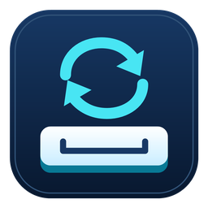

# 自动按键器



一个轻量的 Windows 键盘连按工具。选择一个按键、设置毫秒间隔，即可自动重复按下并松开该键。

## 下载与运行

从 [Releases](https://github.com/stasuy/auto-key-clicker/releases/latest) 下载 `AutoKey.exe`，双击运行。无需安装 Python、Delphi 或第三方运行库。

适用于 Windows 10 / 11。程序为 32 位原生 Windows EXE，也可运行于 64 位 Windows。

## 使用方法

1. 点击“录入按键”，单独按下并松开目标键，例如空格。
2. 输入间隔毫秒数，例如 `100` 表示约每 0.1 秒按一次。
3. 点击“开始（3 秒后）”，在倒计时内切换到接收按键的窗口。
4. 按 `Ctrl+Alt+F8` 开始或暂停，按 `Ctrl+Alt+F9` 退出，也可使用窗口按钮。

程序默认暂停。本工具窗口处于前台时暂不发送，切换到目标窗口后继续发送。

## 支持与限制

- 间隔范围：1–3,600,000 毫秒，实际精度受 Windows 调度影响。
- 支持单个常规键、空格、Enter、方向键、功能键、修饰键及多数媒体键。
- 不录制组合键；Fn 等硬件专用键、安全桌面及 Ctrl+Alt+Delete 不支持。
- 部分应用或游戏可能不接受模拟按键。
- 接收按键的程序若以管理员身份运行，本工具也需相同权限。

## 从源码编译

使用 Delphi 11 Win32 编译器。在仓库根目录运行 `build_delphi.cmd`；脚本默认使用 Delphi 11 的安装路径，其他版本可修改 `DCC` 和 `BRCC` 路径。

```bat
brcc32 AutoKey.rc
dcc32 -B -Q --codepage:65001 AutoKey.dpr
```

源码和资源文件：

- `AutoKey.dpr`：应用源码，界面标题为“自动按键器”。
- `AutoKey.rc` / `AutoKey.ico`：Windows 图标资源，支持 9 种尺寸。
- `assets/AutoKey-icon.svg`：可编辑的矢量图标原稿。

编译后得到 `AutoKey.exe`，分发时只需此文件。
